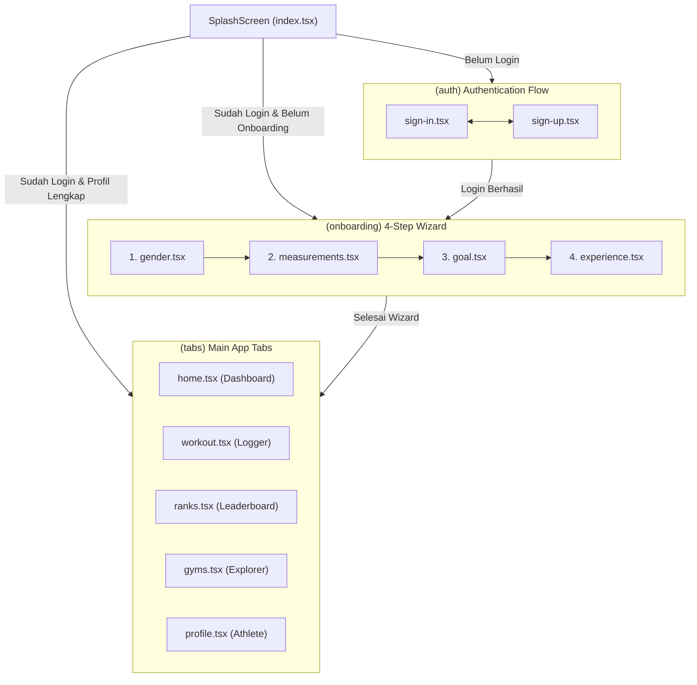

# Feature Flows & Screen Specifications: Gymnix

Dokumen ini mendefinisikan rincian alur pengguna (*User Flow*), logika bisnis, dan spesifikasi antarmuka untuk seluruh modul layar di dalam folder [`src/app/`](file:///D:/UMN/Semester%207/Mobile%20Cross%20Platform/Gymnix/Gymnix/src/app).

---

## 1. Peta Navigasi Aplikasi (Route Map)



---

## 2. Rincian Modul Layar & Alur Bisnis

### 2.1 Inisialisasi & Splash Screen (`src/app/index.tsx`)
* **Tujuan:** Menampilkan *branding* awal Gymnix sembari memeriksa status autentikasi di penyimpanan lokal (MMKV/SecureStore).
* **Komponen & Visual:**
  * Logo resmi `assets/images/gymnix-logo.png` dengan animasi Reanimated (Fade-in `duration: 800ms` & Spring Scale).
  * Area sentuh bebas untuk me-*skip* animasi secara instan.
* **Logika Transisi:**
  * Jika token tidak ada $\rightarrow$ `router.replace('/(auth)/sign-in')`.
  * Jika token valid namun `is_onboarded == false` $\rightarrow$ `router.replace('/(onboarding)/gender')`.
  * Jika token valid dan profil lengkap $\rightarrow$ `router.replace('/(tabs)/home')`.

---

### 2.2 Modul Autentikasi (`src/app/(auth)/`)

#### A. Sign In Screen (`sign-in.tsx`)
* **Input Field:**
  * Email (validasi format email RFC 5322).
  * Password (dengan tombol *toggle* mata untuk lihat/sembunyikan).
* **Aksi & Tombol:**
  * Tombol utama **"Sign In"** (`#BE3144`).
  * Link teks **"Forgot Password?"** di sisi kanan atas field password.
  * Divider teks **"OR CONTINUE WITH"**.
  * Social Auth Buttons: Tombol Apple dan Google dengan tata letak horizontal.
  * Link bawah: *"Don't have an account? Sign Up"*.

#### B. Sign Up Screen (`sign-up.tsx`)
* **Input Field:**
  * Full Name (minimal 3 karakter).
  * Email.
  * Password & Confirm Password (validasi kecocokan sandi & minimal 8 karakter).
* **Aksi:** Tombol **"Create Account"** yang langsung memicu pembuatan sesi dan melanjutkan pengguna ke tahap Onboarding.

---

### 2.3 Modul Onboarding Assessment (`src/app/(onboarding)/`)
Wizard 4-langkah dirancang untuk mengumpulkan data antropometri vital tanpa membingungkan pengguna.

```
[1. Gender] ──> [2. Measurements] ──> [3. Goal] ──> [4. Experience] ──> [Dashboard]
```

#### Langkah 1: Pemilihan Gender (`gender.tsx`)
* **Pertanyaan:** *"What's your gender?"*
* **Komponen:** Dua kartu seleksi besar (*Male* & *Female*). Kartu aktif memiliki latar `#BE3144/10` dan border merah `#BE3144`.
* **Fungsi Bisnis:** Menentukan konstanta perhitungan metabolisme basal (BMR).

#### Langkah 2: Parameter Fisik (`measurements.tsx`)
* **Pertanyaan:** *"Your physical measurements"*
* **Komponen:**
  1. **Tinggi Badan (Height):** Display angka (misal: `178 cm`) dengan *horizontal ruler / slider* halus untuk penyesuaian cepat.
  2. **Berat Badan (Weight):** Display angka (misal: `74.5 kg`) dengan tombol penyesuaian stepper `[-]` dan `[+]` berukuran minimal `48x48 dp`.
  3. **Live Indicator:** Menampilkan indikator perkiraan BMI (*Body Mass Index*) secara real-time di bawah input.

#### Langkah 3: Target Kebugaran (`goal.tsx`)
* **Pertanyaan:** *"What is your primary goal?"*
* **Opsi Pilihan (4 Kartu Radio):**
  1. *Hypertrophy* (Membentuk & Membesarkan Massa Otot)
  2. *Strength* (Meningkatkan Beban Angkatan Maksimal / 1RM)
  3. *Fat Loss* (Defisit Kalori & Pembakaran Lemak)
  4. *General Fitness* (Kebugaran Fisik Menyeluruh)

#### Langkah 4: Frekuensi Latihan & Kalkulasi Akhir (`experience.tsx`)
* **Pertanyaan:** *"How often do you train?"*
* **Pilihan:**
  * *Beginner* (1–2 hari/minggu, Multiplier TDEE: 1.375)
  * *Intermediate* (3–4 hari/minggu, Multiplier TDEE: 1.55)
  * *Advanced* (5+ hari/minggu, Multiplier TDEE: 1.725)
* **Logika Komputasi Server/Client (Formula Mifflin-St Jeor):**
  $$\text{BMR (Pria)} = 10 \times \text{weight (kg)} + 6.25 \times \text{height (cm)} - 5 \times \text{age} + 5$$
  $$\text{BMR (Wanita)} = 10 \times \text{weight (kg)} + 6.25 \times \text{height (cm)} - 5 \times \text{age} - 161$$
  $$\text{TDEE} = \text{BMR} \times \text{Activity Multiplier}$$
  * Target Kalori disesuaikan berdasarkan Goal (misal: *Fat Loss* $= \text{TDEE} - 500\text{ kcal}$, *Hypertrophy* $= \text{TDEE} + 300\text{ kcal}$).
* **Aksi Akhir:** Tombol *"Complete Setup"* mengarahkan langsung ke `/(tabs)/home`.

---

### 2.4 Beranda & Analisis Performa (`src/app/(tabs)/home.tsx`)

1. **Top Header Bar:**
   * Logo teks tebal `GYMNIX` berwarna `#BE3144`.
   * **Streak Badge:** Pill gelap dengan emoji `🔥 4d Streak` yang diperbarui harian.
   * Tombol notifikasi lonceng dengan ikon `notifications-outline`.
2. **Today's Split Highlight Card:**
   * Judul split aktif (misal: *Push Day A*), estimasi waktu (*~50m*), dan jumlah gerakan (*5 Exercises*).
   * Badge status `READY` berwarna hijau emerald.
   * Horizontal pills gerakan: *Incline DB Press, Overhead Press, Cable Flys, +2 more*.
   * Tombol CTA utama: **"Start Session"** dengan ikon Play yang langsung membuka sesi latihan aktif.
3. **Dual Metric Cards:**
   * **Daily Target:** Target kalori (`2,450 kcal`) hasil kalkulasi onboarding.
   * **Current Weight:** Berat badan terkini (`74.5 kg`) beserta status progres (`On track (-0.3kg)`).
4. **Weekly Volume Tonnage Bar Chart:**
   * Ringkasan total tonase terangkat dalam seminggu (`14,820 kg`).
   * Grafik batang 7 hari (M, T, W, T, F, S, S) dengan batang merah solid untuk hari aktif, garis putus-putus (*dashed*) untuk estimasi, dan bar rendah abu-abu untuk hari istirahat (*Rest*).
5. **Personal Record (PR) Trophy Card:**
   * Menampilkan rekor angkatan terbaru (misal: *Barbell Bench Press 80 kg (+2.5 kg)*) dengan ikon trofi emas/merah.

---

### 2.5 Pencatatan Latihan / Workout Logger (`src/app/(tabs)/workout.tsx`)

1. **Header & Riwayat:**
   * Tombol pintas **"History"** untuk meninjau log latihan tanggal-tanggal sebelumnya.
2. **Quick Start Banner:**
   * Tombol **"Start Empty Workout"** untuk lifter yang ingin langsung mencatat gerakan bebas tanpa template.
3. **Filter Template Latihan:**
   * Filter Chips horizontal: *All, Hypertrophy, Strength, Fat Loss, Bodyweight*.
4. **Alur Logger Aktif (Active Session Overlay):**
   * **Session Timer:** Jam digital berjalan di bagian atas (*00:42:15*).
   * **Tabel Set Tiap Gerakan:**
     * Kolom: Set #, *Previous* (beban sesi lalu sebagai referensi), *kg* (input beban), *Reps* (input repetisi), dan Tombol Centang.
     * Mengisi beban & reps lalu menekan centang memicu getaran haptic dan mengaktifkan **Rest Timer** otomatis (hitung mundur 90 detik).
   * **Tombol "Add Exercise":** Membuka katalog pencarian latihan lokal.
   * **Tombol "Finish Workout":** Menghitung total volume kg, menyimpan status sesi ke `COMPLETED`, dan memperbarui streak harian.

---

### 2.6 Papan Peringkat / Gamifikasi (`src/app/(tabs)/ranks.tsx`)

1. **Pinned Athlete Rank Card:**
   * Menampilkan peringkat pengguna saat ini (misal: *#14 Alex Pratama*), total volume (`48,250 kg`), perolehan poin (`2,840 pts`), dan tier aktif (`Diamond II`).
2. **Segmented Scope Selector:**
   * Toggle **"Global"** (seluruh atlet di platform) vs **"Local Gym"** (hanya atlet yang bernaung di gym yang sama).
3. **Tier Selector Chips:**
   * *Bronze, Silver, Gold, Platinum, Diamond*.
4. **Leaderboard List Items:**
   * Menampilkan Rank (#1, #2, dst.), nama atlet, afiliasi gym, volume terangkat, dan badge pergerakan tren (*+2* hijau / *-1* abu-abu).

---

### 2.7 Direktori Gym (`src/app/(tabs)/gyms.tsx`)

1. **Header & Location Dropdown:**
   * Pilihan lokasi aktif (misal: *"Jakarta Selatan"*).
2. **Search Bar:** Input pencarian gym berdasarkan nama atau area.
3. **Filter Chips:**
   * *All, Nearest (< 3 km), Open Now, Free Weights, 24/7 Access*.
4. **Daftar Kartu Gym:**
   * Nama gym (misal: *Pandawa Gym, Olympus Gym, Apex Athletic Club*).
   * Rating bintang (misal: `4.9`), jarak tempuh (`1.4 km`), dan jam operasional.
   * Tag fasilitas: *Olympic Lifting, Sauna, Ice Bath, Monolift, Calisthenics*.
   * Tombol opsi untuk menjadikan gym sebagai *"Home Gym"* di profil atlet.

---

### 2.8 Profil Atlet (`src/app/(tabs)/profile.tsx`)

1. **Athlete Header:**
   * Inisial Avatar lingkaran (`AP`), Nama Lengkap, username `@alexpratama`, tanggal bergabung, dan pill konsistensi `🔥 4-Day Fire`.
   * Informasi Home Gym tempat bernaung (*Iron District Metro Gym*).
   * Tombol cepat **"Edit Bio & Vitals"**.
2. **Statistik Personal Best (PR Showcase):**
   * Kartu 1RM (One Rep Max) untuk angkatan utama: Bench Press, Back Squat, Deadlift, Overhead Press.
3. **Pengaturan & Menu Akun:**
   * *Workout History & Export Data*.
   * *Offline Sync Status* (memeriksa antrean data tertunda).
   * *App Preferences* (Satuan kg/lbs, tema, durasi rest timer default).
   * *Sign Out Button*.
