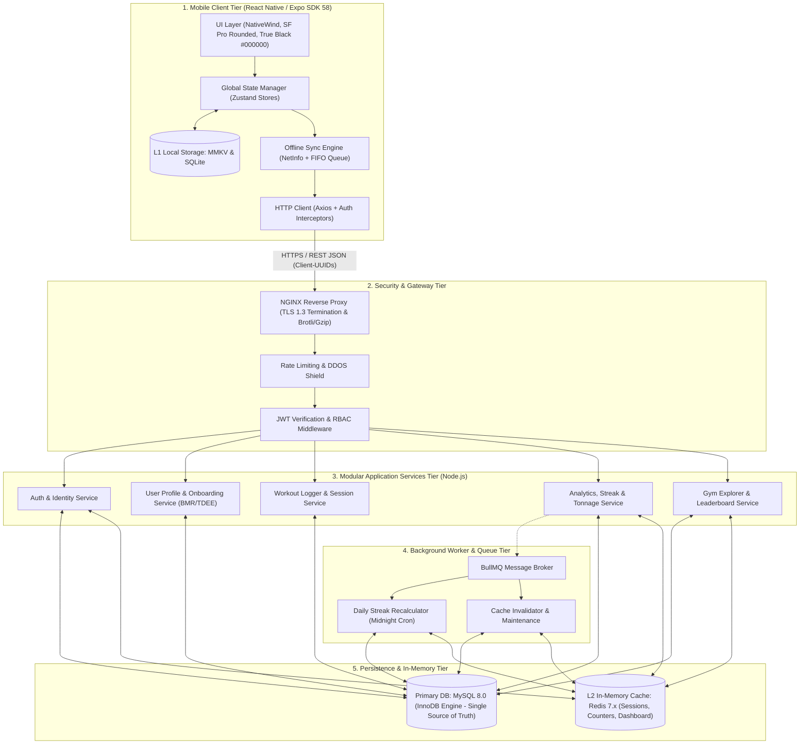

# System Architecture & Offline-First Sync Specification: Gymnix

Dokumen ini menjelaskan arsitektur teknis end-to-end, pemisahan lapisan sistem (*multi-tier architecture*), manajemen *state* pada aplikasi mobile, serta mekanisme **Offline-First Synchronization Engine** pada aplikasi **Gymnix**.

---

## 1. Arsitektur Sistem Menyeluruh (5-Tier Architecture)

Sistem Gymnix dirancang dengan arsitektur berorientasi ketahanan (*resilience*) untuk menjamin ketersediaan tinggi di kondisi jaringan buruk:



---

## 2. Arsitektur Client-Side State Management (Zustand)

Manajemen state aplikasi mobile menggunakan **Zustand** karena sifatnya yang ringan (*zero-boilerplate*), performa tinggi, dan mudah dihubungkan dengan *storage middleware* lokal.

### Pembagian Slices State:

1. **`useAuthStore`:**
   * State: `user`, `accessToken`, `refreshToken`, `isAuthenticated`, `isOnboarded`.
   * Persistensi: Menggunakan MMKV terenkripsi (*Secure KeyStore/Keychain*).
2. **`useWorkoutSessionStore`:**
   * State: `activeSessionId`, `startTime`, `elapsedSeconds`, `templateId`, `exercises: []`, `isRestTimerRunning`, `restRemainingSeconds`.
   * Operasi: `startSession()`, `addExercise()`, `logSet(exerciseId, setNumber, weight, reps)`, `removeSet()`, `finishSession()`.
   * Karakteristik: Seluruh perubahan mutasi set langsung disimpan ke *local storage* secara real-time.
3. **`useOfflineSyncStore`:**
   * State: `mutationQueue: []`, `isSyncing: boolean`, `lastSyncedAt: Date`, `pendingMutationsCount: number`.
   * Operasi: `enqueueMutation(mutation)`, `flushQueue()`, `clearFailedMutations()`.

---

## 3. Strategi Offline-First & Sync Engine

### 3.1 Permasalahan Sinyal di Gym
Area gym (terutama *basement*, lantai bawah tanah, atau gedung tertutup logam) sering kali mengalami sinyal seluler nol atau *intermittent* (terputus-putus). Jika aplikasi bergantung pada request-response synchronous server, lifter akan mengalami *freezing screen*, tombol berputar (*loading spinners*), atau data set yang hilang.

### 3.2 Tiga Pilar Mekanisme Offline Gymnix

#### 1. Client-Generated UUIDs (v4)
* **Aturan Mutlak:** Primary Key untuk tabel `workout_sessions`, `session_exercises`, dan `exercise_sets` dibuat di sisi ponsel menggunakan `uuidv4()` saat tombol ditekan.
* **Manfaat:** Data memiliki identitas permanen sebelum dikirim ke backend. Tidak ada ketergantungan pada *auto-increment ID* server, sehingga set dapat dibuat, diubah, atau dihapus saat offline tanpa risiko benturan ID (*ID collision*).

#### 2. Optimistic UI Updates
* Ketika pengguna menekan tombol centang pada baris set latihan:
  1. UI segera berubah menjadi centang aktif merah `#BE3144`.
  2. Getaran taktil (*haptic pulse*) aktif.
  3. Data langsung ditulis ke penyimpanan lokal (MMKV/SQLite).
  4. Sebuah event mutasi dimasukkan ke dalam antrean sinkronisasi (*FIFO Mutation Queue*).

#### 3. FIFO Mutation Queue & Batch Synchronization
Struktur objek antrean mutasi offline:
```typescript
interface OfflineMutation {
  id: string;               // UUID lokal untuk mutasi
  endpoint: string;         // e.g., '/api/workouts/sessions/sets'
  method: 'POST' | 'PUT' | 'DELETE';
  payload: Record<string, any>;
  timestamp: number;        // UTC epoch millis
  retryCount: number;
}
```

* **Alur Sinkronisasi Saat Jaringan Terhubung:**
  ```mermaid
  sequenceDiagram
      autonumber
      participant App as Gymnix Mobile App
      participant Net as NetInfo Listener
      participant Queue as Local Mutation Queue (MMKV)
      participant API as Backend Gateway (/batch-sync)
      participant DB as MySQL 8.0 (InnoDB)

      App->>Queue: Simpan Set Latihan (Offline UUID)
      Note over App,Queue: State lokal diperbarui < 5ms (Optimistic)
      
      Net-->>App: Event Online: Koneksi Internet Pulih
      App->>Queue: Baca seluruh antrean tertunda (FIFO)
      App->>API: POST /api/workouts/sessions/batch-sync (Array of mutations)
      
      rect rgb(15, 23, 42)
          Note over API,DB: Jalankan Transaksi Atomik (InnoDB)
          API->>DB: INSERT / UPDATE Sets ON DUPLICATE KEY UPDATE
          DB-->>API: Transaksi Berhasil (Commit)
      end
      
      API-->>App: HTTP 200 { success: true, synced_count: 5 }
      App->>Queue: Bersihkan mutasi yang berhasil (Purge Queue)
      App->>App: Perbarui UI (Sync Badge: All Synced)
  ```

### 3.3 Resolusi Konflik (Conflict Resolution)
* **Skenario Update Set Bersamaan:** Menggunakan prinsip **"Last-Write-Wins" (LWW)** berdasarkan `timestamp` milidetik UTC klien.
* **Skenario Idempotensi:** Endpoint `/api/workouts/sessions/sets` dan `/batch-sync` bersifat *idempotent*. Jika paket jaringan dikirim ulang (*retry*) karena timeout, database menggunakan klausa `ON DUPLICATE KEY UPDATE` berbasis UUID sehingga tidak akan menghasilkan baris duplikat.

---

## 4. Multi-Tier Caching Architecture

Untuk mencapai performa respons sub-50ms di perangkat:

```
[Mobile Storage: MMKV & SQLite (L1 Cache)]
        ↓  (HTTPS TLS 1.3)
[Gateway: NGINX Reverse Proxy (Static Cache)]
        ↓  
[Server In-Memory: Redis 7.x (L2 Cache)]
        ↓  (Cache Miss)
[Primary DB: MySQL 8.0 (InnoDB Engine)]
```

| Tingkat Cache | Teknologi | Objek yang Disimpan | TTL / Masa Berlaku | Strategi Invalidasi |
| :--- | :--- | :--- | :--- | :--- |
| **L1 (Client)** | MMKV / SQLite | Sesi berjalan, set offline, katalog gerakan lokal, beban lalu (`previous_weight`) | Permanen / Sesi | Dihapus setelah sesi selesai & tersinkronisasi |
| **Gateway** | NGINX | Katalog latihan umum, daftar kategori otot, aset statis | 1 Jam | Otomatis via header `ETag` |
| **L2 (Server)** | Redis 7.x | Summary dashboard pengguna, grafik tonase mingguan, JWT blacklist | 15 Menit | Langsung di-*purge* saat sesi diselesaikan (`finishSession`) |
| **Database** | MySQL 8.0 | *Single Source of Truth* seluruh entitas | Permanen | ACID Transactional Commit |

---

## 5. Keamanan & Penanganan Sesi Jaringan

1. **Token Flow:**
   * Access Token JWT berumur pendek (15 menit).
   * Refresh Token berumur panjang (30 hari) disimpan dalam *SecureStore* perangkat dengan rotasi token setiap kali digunakan (*Refresh Token Rotation*).
2. **Offline Grace Period:**
   * Aplikasi mengizinkan pengguna tetap melakukan pencatatan latihan offline meskipun masa berlaku Access Token habis saat tidak ada internet, selama sesi lokal belum di-*logout* secara eksplisit. Validasi token ditangguhkan hingga koneksi internet kembali pulih.
